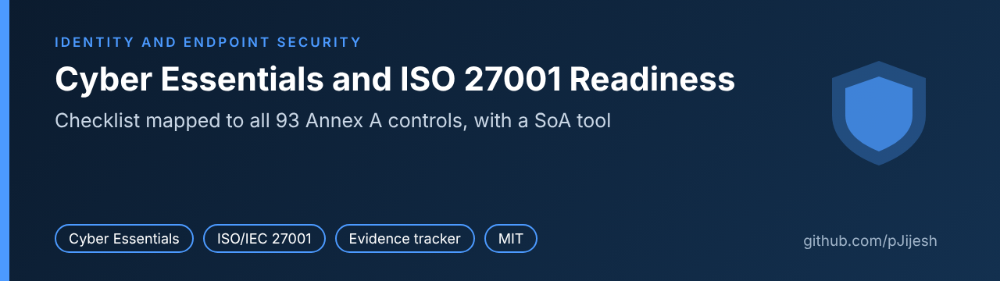

# cyber-essentials-plus-iso27001-readiness



[](https://github.com/pJijesh/cyber-essentials-plus-iso27001-readiness/actions/workflows/test.yml) [](LICENSE)  

**Problem:** UK groups preparing for Cyber Essentials Plus and ISO/IEC 27001 often treat them as one project or as two unrelated ones, lose track of evidence, and apply either one heavy standard or no standard at all to sites in different countries.

**For:** IT leaders and security leads who need a clear view of where the group stands, how the two schemes relate, and what each site should be expected to do.

**Demonstrates:** a plain-English Cyber Essentials checklist mapped to all 93 ISO/IEC 27001 Annex A controls, a dependency-free Python tool that tracks evidence, scores gaps and drafts a Statement of Applicability, and a documented, adjustable way to set proportionate controls by site.

The example is a fictional manufacturing group with six sites in five countries. All names, sites and figures are invented. No real organisation, person or assessment result appears in this repository.

> **Not legal or certification advice.** Cyber Essentials is a baseline subset of what ISO/IEC 27001 expects, so certification to one does not imply the other. The mapping is the author's judgement, not an official crosswalk. The site tiering model is generic and states nothing about any country's law. Check current requirements with the NCSC, IASME and your certification body.



## What it does

- **Reference data** (`data/`): 45 Cyber Essentials checklist items in plain English (the five technical themes plus scope and inventory), all 93 Annex A controls with short titles, and a mapping from each checklist item to the controls it helps with, including the 63 controls that Cyber Essentials does not touch.
- **`init`** creates an assessment workbook, a CSV with `id`, `status`, `owner`, `evidence_ref`, `last_reviewed` and `notes`. Status is one of not started, partial, implemented or not applicable.
- **`score`** reads the workbook and writes coverage by theme, gaps (the Cyber Essentials automatic fail areas first), overdue evidence reviews, items missing evidence or a review date, a draft Statement of Applicability (justification required for every not applicable item), a Markdown report and JSON.
- **`sites`** reads a sites CSV and gives each site a risk score, a proportionate tier and the minimum control set for that tier, using factors, weights, thresholds and control sets in `config/site-tiering.json`.
- **Docs** (`docs/`): how the schemes differ and fit together, a suggested sequence and timeline, a scoping guide, how to prepare for the Plus technical test, an ISO/IEC 27001 roadmap, proportionate controls for multi-country groups, and a cost and effort outline with no prices.

## Quick start

Requires Python 3.10 or later. No third-party packages. Run from a checkout of the repository.

```bash
python -m readiness init --out assessment.csv --with-titles
# fill in status, owner, evidence_ref, last_reviewed, notes in a spreadsheet or editor
python -m readiness score --workbook assessment.csv --out output
python -m readiness sites --sites examples/sites.csv --out output
```

To reproduce the committed worked example exactly:

```bash
python -m readiness score --workbook examples/assessment.csv --out /tmp/out-score --as-of 2026-11-11
python -m readiness sites --sites examples/sites.csv --out /tmp/out-sites
```

Output from the first command on the example workbook:

```text
Scored assessment.csv as of 2026-11-11
  Cyber Essentials: coverage 72.7% (24 implemented, 16 partial, 4 not started, 1 not applicable)
  ISO Annex A: coverage 37.9% (14 implemented, 38 partial, 35 not started, 6 not applicable)
  Gaps: 93. Overdue reviews: 19. No review date: 3. Missing evidence: 5
  SoA draft: 87 included, 6 excluded, 79 still need a justification
```

Options: `--as-of YYYY-MM-DD` fixes the date used for review ageing (default today), `--review-days` sets how old evidence may be before it is overdue (default 365, matching the 12 month certificate cycle), `--fail-under PERCENT` exits with status 3 when any scope is below that coverage, and `--config` on `sites` points at an alternative tiering file. Bad input stops the run with every problem listed and exit status 2.

## Worked example

`examples/` holds a fictional group, **Tarnmoor Industrial Group (fictional)**, with six sites in five countries and a partly completed assessment.

| Site | Country | Score | Tier |
| --- | --- | ---: | --- |
| Ashgrove Plant | Mexico | 72.7 | 3 Full |
| Northgate Works | United Kingdom | 72.7 | 3 Full |
| Rhenmark Plant | Germany | 63.6 | 2 Enhanced |
| Calder Design Studio | United Kingdom | 40.9 | 2 Enhanced |
| Silvermere Assembly | Poland | 36.4 | 2 Enhanced |
| Tidewater Sales Office | Malaysia | 31.8 | 1 Baseline |

Source: `examples/output-sites/site-tiers.csv`. Coverage by theme for the example assessment:

| Theme | Coverage |
| --- | ---: |
| CE: Scope and inventory | 75.0% |
| CE: Firewalls | 75.0% |
| CE: Secure configuration | 83.3% |
| CE: Security update management | 28.6% |
| CE: User access control | 83.3% |
| CE: Malware protection | 100.0% |
| ISO: Organisational | 25.7% |
| ISO: People | 50.0% |
| ISO: Physical | 46.4% |
| ISO: Technological | 46.4% |

Source: `examples/output-score/report.json`. The story it tells: the group looks strong on general Cyber Essentials coverage, but security update management is weak and all five automatic fail areas (cloud MFA, supported software, removal of unsupported software, and 14 day patching of operating systems and of applications) are still open, so a Plus audit booked now would be at risk. The ISO position is early, as expected, with 79 included controls still lacking a justification in the draft Statement of Applicability.

Committed outputs: [`report.md`](examples/output-score/report.md), [`report.json`](examples/output-score/report.json), [`soa.md`](examples/output-score/soa.md), [`soa.csv`](examples/output-score/soa.csv), [`sites-report.md`](examples/output-sites/sites-report.md), [`site-tiers.csv`](examples/output-sites/site-tiers.csv), [`tier-control-sets.csv`](examples/output-sites/tier-control-sets.csv).

## How it is built

```text
.
├── README.md, LICENSE, CONTRIBUTING.md
├── data/
│   ├── ce-requirements.csv          45 checklist items (own words)
│   ├── iso27001-annexa.csv          93 Annex A controls, short titles (own words)
│   └── mapping-ce-to-iso.csv        CE item to Annex A control, strong or partial, plus none rows
├── readiness/                       standard library only
│   ├── cli.py                       init, score, sites
│   ├── datafiles.py, csvio.py       loading and validating CSV
│   ├── workbook.py                  create and read the assessment workbook
│   ├── scoring.py, report.py        coverage, gaps, evidence hygiene, Markdown
│   ├── soa.py                       Statement of Applicability draft
│   └── sites.py                     config loading, tiering, control sets
├── config/site-tiering.json         factors, weights, thresholds, floors, tiers
├── docs/                            guides, sources, diagram sources and SVGs
├── examples/                        fictional group: inputs and generated outputs
├── scripts/build_examples.py        regenerates examples/ deterministically
├── tests/                           pytest suite
└── .github/workflows/test.yml       Python 3.10 to 3.13
```

Documentation: [Cyber Essentials, Plus and ISO compared](docs/ce-and-iso-compared.md), [sequence and timeline](docs/sequence-and-timeline.md), [scoping guide](docs/scoping-guide.md), [preparing for the Plus technical test](docs/ce-plus-technical-test.md), [ISO/IEC 27001 roadmap](docs/iso27001-roadmap.md), [proportionate controls](docs/proportionate-controls.md), [cost and effort](docs/cost-and-effort.md), [data and formats](docs/data-and-formats.md), [sources and verification](docs/sources.md).

## Design choices

- **Plain files, no dependencies.** The workbook is a CSV that any spreadsheet opens. Output is deterministic (sorted, Unix line endings, no timestamps) so it can be diffed and kept as audit evidence.
- **Honest scoring.** Implemented counts 1, partial 0.5, not started 0, and not applicable leaves the denominator. Not applicable needs a written justification, because that is what an assessor or auditor will ask for. The percentage is a progress indicator, not a pass mark.
- **Automatic fail areas are separate.** A good average can hide a failure that the scheme treats as automatic, so those items are listed first and apart from the coverage figure.
- **CE is a subset, and the mapping says so.** No Annex A control is marked fully covered. Each link is strong or partial, and the 63 controls with no Cyber Essentials item are listed with a reason.
- **The tiering model is a config file, not code.** Factors, weights, thresholds, floors and control sets can be argued over and changed without touching Python. Floors can only raise a tier. Tiers never reduce Cyber Essentials requirements for sites inside the certified scope.
- **No legal claims.** The only legal input is a free text column that passes through unread.

## Limitations

- It tracks self-reported status. It does not scan devices, read configurations or check evidence. A high score is not an assessment.
- The Cyber Essentials checklist is the author's plain-English reading of the requirements, not the official question set. The mapping to Annex A is judgement and not endorsed by the NCSC, IASME or ISO.
- Scheme rules change. The facts reflect pages read on 11 November 2026, and some retest and sampling details came only from secondary sources. See [docs/sources.md](docs/sources.md).
- The ISO/IEC 27001 standard text is paywalled and was not read. The clause structure is described from public summaries.
- The Statement of Applicability is a draft table, not a finished document. Risk assessment, risk treatment and reasons for inclusion remain human work.
- The default tiering factors, weights, thresholds and control sets are examples. They have not been validated against real incidents or any regulator's view.
- The example is synthetic. The tool has not been run on a real organisation's assessment.
- Cost guidance has no prices, by design.

## Verification status

Checked on 11 November 2026. The full table is in [docs/sources.md](docs/sources.md).

- **From NCSC, IASME or ISO public pages:** the Cyber Essentials requirements version (v3.3, April 2026), the five technical themes, the scope rules, the 2026 changes (cloud scoping, MFA as an automatic fail, 14 day updates, unsupported software), the question set name, the Plus test design (from the v3.2 test specification), the Plus audit overview and the three month window from the IASME pages, the 12 month certificate life, the ISO/IEC 27001:2022 edition and Amendment 1:2024.
- **From secondary sources:** the 93 control count and the 37, 8, 14 and 34 theme counts (two independent lists agreed), control numbers and titles, the 114 to 93 change and 11 new controls, the 31 October 2025 end of 2013 certificates, clause summaries, the three year ISO certification cycle, the 30 day Plus remediation claim and the Plus sample size table (both flagged as unverified in the docs).
- **Not verified:** a Plus test specification newer than v3.2, the exact v3.3 start date (26 or 27 April), clause 6.1.2 and 6.1.3 wording, and any prices.
- **Run here:** all 72 tests pass on Python 3.13 and the commands above were run on the example data. The command line output was identical on Python 3.11 and 3.12 (pytest was not installed there). Python 3.10 was not available locally, so it was only syntax checked. The CI workflow covers 3.10 to 3.13. Diagrams were rendered with the Mermaid CLI and checked visually.
- **Not run:** the tool has not been used on a real assessment, and no certification body or assessor has reviewed the checklist or the mapping.

## Tests

```bash
pip install pytest
python -m pytest -q
```

The suite checks the reference data (45 items, 93 controls, 37/8/14/34 themes, mapping completeness), workbook validation errors with line numbers, scoring against hand-calculated values (for example 4 implemented and 2 partial of 7 applicable gives 71.4%), review ageing at the exact boundary, Statement of Applicability rules, tier scores for the six example sites, floors, band edges and threshold edges, config validation messages, an end-to-end run of the command line, byte-for-byte determinism, a check that the committed examples match a fresh run, and that no em or en dashes appear and relative links resolve.

## Roadmap

Planned, not promised. Order and timing change with other work.

- **Next:** Recheck requirements version on the NCSC site; Add evidence request templates
- **Then:** Add ISO 27001 internal audit checklist; Add management review pack
- **Later:** Add supplier assurance questionnaire; Release v1.1

## Licence

MIT. See [LICENSE](LICENSE). Contributions are welcome, see [CONTRIBUTING](CONTRIBUTING.md).

Built by Puliyappottammal Jijesh, an IT manager. [LinkedIn](https://www.linkedin.com/in/pjijesh) | [GitHub](https://github.com/pJijesh)
