# Cyber Essentials, Cyber Essentials Plus and ISO/IEC 27001 compared

This page explains how the three fit together. It is a planning aid, not advice on which certification a customer, insurer or regulator will accept. Facts are paraphrased from public pages. See [sources.md](sources.md) for where each came from and how it was checked.

## The short version

- **Cyber Essentials (CE)** is a UK scheme developed by the NCSC and delivered by IASME. It sets a minimum set of technical controls under five themes: firewalls, secure configuration, user access control, malware protection and security update management. The organisation completes a verified self-assessment, a board member or equivalent signs it, and an assessor marks it.
- **Cyber Essentials Plus (CE+)** uses the same requirements. The difference is evidence: an assessor tests the controls on your systems, including an external vulnerability scan and tests on a sample of devices, rather than relying on answers alone.
- **ISO/IEC 27001:2022** is an international standard for an information security management system (ISMS). It is about running security as a managed, risk-based process. It has requirements in clauses 4 to 10 and a reference set of 93 controls in Annex A, which an organisation selects from and records in a Statement of Applicability.

## Differences that matter

| Question | Cyber Essentials | Cyber Essentials Plus | ISO/IEC 27001 |
| --- | --- | --- | --- |
| What is assessed | Answers to a question set about technical controls | The same controls, tested on real systems | A management system and the controls chosen to treat your risks |
| Who decides which controls apply | The scheme (fixed requirements) | The scheme (fixed requirements) | You, through a risk assessment and the Statement of Applicability |
| Breadth | Technical hygiene only | Technical hygiene only | People, physical, supplier, legal, continuity and technical topics |
| Evidence type | Self-assessment, marked by an assessor | Hands-on testing by an assessor | Audit of documents, records and interviews by a certification body |
| Certificate life | 12 months, then renew | 12 months, then renew | Three year cycle with annual surveillance audits |
| Fails on | Missing requirements, with some automatic fail areas | Failed tests, for example missing high or critical updates older than 14 days | Major nonconformities that are not corrected |

## How they overlap

The data files in this repository map every Cyber Essentials checklist item to the Annex A controls it helps with ([data/mapping-ce-to-iso.csv](../data/mapping-ce-to-iso.csv)). Counted from that file:

- All 45 checklist items map to at least one Annex A control.
- 30 of the 93 Annex A controls receive a contribution from at least one CE item.
- 63 Annex A controls have no CE item at all. They cover areas such as policies, supplier agreements, incident management, continuity, people screening, physical security and logging.
- No Annex A control is marked as fully covered by CE. Each contribution is marked strong or partial, and even a strong contribution leaves work to do.

**Caveat.** Cyber Essentials is a baseline subset of the controls an ISMS would normally consider. Certification to one does not imply the other. A CE or CE+ certificate does not give you an ISO/IEC 27001 certificate, and an ISO certificate does not satisfy the Cyber Essentials requirements unless the scope and technical controls also meet them. The mapping is a working aid based on judgement. It is not an official crosswalk and neither the NCSC, IASME nor ISO has endorsed it.

## What CE+ adds for ISO preparation

Evidence from a CE+ test (scan results, device test results, remediation records) is useful input to several Annex A controls, mainly technical vulnerability management, malware protection, secure authentication and configuration management. It does not replace the ISMS requirements, internal audit or management review.

## When each is the right first step

- A customer, tender or insurer asks for Cyber Essentials or Plus: do that first. It is quicker and the technical work is needed for ISO anyway.
- A customer asks for ISO/IEC 27001: plan the ISMS, but still close the Cyber Essentials gaps early. They are the cheapest high-value controls.
- Both are requested: follow the sequence in [sequence-and-timeline.md](sequence-and-timeline.md).
