# Proportionate controls for multi-country groups

Groups often set one control standard for every site, which is too heavy for a small sales office, or leave each site to decide, which leaves gaps. The `sites` command applies a simple, documented model so each site gets a tier that matches its risk, with a clear minimum control set per tier.

> This is a prioritisation model for internal governance. It is not legal advice. It does not state what any country's law requires and it does not judge whether a site is compliant with any law. The only legal input is a free text column that you complete with local advice. The model, weights and control sets are examples to adjust.

## What the model does

1. Reads one row per site with: `site`, `country`, `headcount`, `data_sensitivity`, `regulated_data`, `it_maturity`, `connectivity`, and an optional `local_requirements_note`.
2. Converts each factor into points using the config file `config/site-tiering.json`. Headcount uses bands. The others use a lookup (for example `data_sensitivity` low, medium, high).
3. Multiplies points by factor weights and expresses the total as a share of the maximum, from 0 to 100.
4. Chooses a tier from the thresholds (default 35 and 65).
5. Applies floor rules, which can only raise a tier. The defaults say a site with regulated data, or highly sensitive data, is never in the lowest tier, and a site with both is in the highest.
6. Gives the site the minimum control set of its final tier. Tiers are cumulative.

## The default model

| Factor | Weight | Points scale (maximum 4) | Why it is there |
| --- | --- | --- | --- |
| headcount | 2 | up to 10: 0, up to 50: 1, up to 150: 2, up to 300: 3, above 300: 4 | More people means more accounts and devices |
| data_sensitivity | 3 | low 0, medium 2, high 4 | Impact of exposure |
| regulated_data | 3 | no 0, unknown 2, yes 4 | Whether an obligation exists. The model only records the answer |
| it_maturity | 2 | high 0, medium 2, low 4 | Weaker local management raises residual risk |
| connectivity | 1 | good 0, adequate 2, poor 4 | Poor links make patching and monitoring harder |

Score = 100 x sum(weight x points) / sum(weight x maximum points). The maximum is 44 with the default weights, so for example a site with weighted points of 32 scores 72.7.

## The default tiers

| Tier | Name | Minimum control set | Suggested assurance |
| --- | --- | --- | --- |
| 1 | Baseline | The five Cyber Essentials technical themes (37 items) plus the device inventory and cloud service register | Annual self-attestation by the site lead, spot checked by group IT |
| 2 | Enhanced | All 45 checklist items plus 25 Annex A management controls (policy, roles, access lifecycle, supplier and cloud oversight, training, incident reporting, backup, logging and similar) | Annual review by group security with sampled evidence, plus a remote technical check |
| 3 | Full | All 45 checklist items plus all 93 Annex A controls considered through the Statement of Applicability | Internal audit in the ISMS programme, management review input, independent technical testing |

The exact lists are in `config/site-tiering.json` and, after a run, in `tier-control-sets.csv`.

## Tiers do not reduce Cyber Essentials requirements

Tiering decides how much local governance and assurance a site needs. It does not make Cyber Essentials requirements optional. If a site's devices and services are inside the certified Cyber Essentials scope, every in-scope device and cloud service must meet the scheme requirements, whatever its tier. A site that cannot meet them has two honest options: fix the gaps, or separate it from the scope so that the separation can be shown to the assessor.

Tier 1 is deliberately not "no controls". The baseline is cheap to meet when devices are cloud managed, and it is the part customers and insurers ask about.

## How a small site meets Tier 1 without local IT staff

- Devices are enrolled in central management that enforces updates, firewall, disk encryption, screen lock and malware protection. The author's [intune-endpoint-baseline](https://github.com/pJijesh/intune-endpoint-baseline) shows one example of this approach.
- Accounts and MFA are managed centrally from the group directory.
- The local router is replaced or managed by the group, or the site relies on device firewalls and a managed VPN.
- The site lead completes a short annual attestation and keeps a device list.

## Adjusting the model

Edit `config/site-tiering.json` and rerun. The tool checks the file and reports problems in plain language (unknown factors, thresholds that do not increase, tiers that reference unknown controls, Cyber Essentials items that no tier includes).

- **Weights.** Set a weight to 0 to ignore a factor. Increase `regulated_data` if your group's customers or contracts require stricter handling.
- **Thresholds.** Lower them if you want more sites in the higher tiers.
- **Floors.** Add rules such as "poor connectivity and low IT maturity never in tier 1". Floors test category factors only.
- **Control sets.** Move controls between tiers with `add_ids` and `add_themes`.
- **Number of tiers.** Add or remove tiers as long as the thresholds count is one less than the tiers.

Document why you changed anything. The point is a defensible, repeatable decision, not a perfect score.

## Local requirements column

Fill `local_requirements_note` with advice from local counsel or your data protection lead, for example which regulator, contract or customer clause applies. The tool carries it through to the reports unchanged, and shows "not completed" if it is empty. It never reads it. A tier is not a statement of legal compliance.

## Review

Re-run the tiering when headcount, data handled, IT maturity or connectivity change, after an acquisition, and at least once a year. Use the group management review to confirm the tiers.
