# Suggested sequence and timeline for a group

This is a planning pattern for a UK parent with several sites, some in other countries. The durations are illustrative assumptions for planning, not benchmarks. Your own timeline depends on current maturity, scope, team capacity and the availability of assessors and certification bodies.

## Principles

1. **Do the technical baseline first.** The Cyber Essentials themes (MFA on cloud services, patching within 14 days, no unsupported software, sensible firewall and account hygiene) are needed by every route.
2. **Decide scope early and write it down.** Two scopes are involved: the Cyber Essentials boundary and the ISMS scope. They need not be identical, but differences must be deliberate. See [scoping-guide.md](scoping-guide.md).
3. **Run the ISMS build in parallel, not after.** Risk assessment and policy work take calendar time because they depend on other people.
4. **Treat Plus as a date-bound event.** The Plus audit has to follow the basic certificate within a short window, so prepare before you certify.

## Phases

| Phase | Illustrative duration | Main outputs | Repository support |
| --- | --- | --- | --- |
| 1. Mandate and scope | 2 to 4 weeks | Board sponsor, named owner, list of legal entities and sites, draft scope for both schemes | [scoping-guide.md](scoping-guide.md) |
| 2. Baseline | 3 to 6 weeks | Gap view for CE and Annex A, site tiers, owners assigned | `init`, `score`, `sites` |
| 3. Close CE gaps | 2 to 4 months | Cloud MFA enforced, patch process proven, unsupported software removed or isolated, inventory accurate | [ce-plus-technical-test.md](ce-plus-technical-test.md) |
| 4. CE verified self-assessment | 1 to 3 weeks | Completed answers, board declaration, certificate | `score` evidence checks |
| 5. CE+ audit | Within the Plus window after phase 4 | Scan results, sample test results, Plus certificate | [ce-plus-technical-test.md](ce-plus-technical-test.md) |
| 6. ISMS build (parallel from phase 2) | 6 to 9 months | Risk method, risk register, treatment plan, Statement of Applicability, policies, training | [iso27001-roadmap.md](iso27001-roadmap.md) |
| 7. Internal audit and management review | 4 to 8 weeks | Audit report, corrective actions, management review minutes | [iso27001-roadmap.md](iso27001-roadmap.md) |
| 8. Certification audit | Stage 1 then Stage 2, scheduled with the certification body | ISO certificate | [iso27001-roadmap.md](iso27001-roadmap.md) |
| 9. Run | Yearly | CE and CE+ renewal, ISO surveillance audits, ISMS improvement | `score` overdue review checks |

## Timing rules to verify at the time

These were checked on 11 November 2026 (details in [sources.md](sources.md)). Confirm them with your assessor or certification body before fixing dates.

- The IASME Cyber Essentials Plus page says the Plus audit must be completed within three months of the last basic certification, and that a recent basic certificate lets you skip the self-assessment questions. Another certification body repeats the three month rule.
- Cyber Essentials and Cyber Essentials Plus certificates run for 12 months.
- Under the April 2026 changes, the self-assessment must be finished and unchanged before Plus testing begins.
- ISO certification lasts three years with annual surveillance audits (certification body guidance).

## Group considerations

- Sequence sites by tier. Tier 3 sites (see [proportionate-controls.md](proportionate-controls.md)) are the ones inside the ISMS scope and need the longest lead time.
- A multi-entity scope for Cyber Essentials needs each legal entity listed. Check with your Certification Body whether separate certificates per entity are useful to you.
- Time zones and languages affect evidence collection and interviews. Allow extra time for sites outside the UK.
- Avoid scheduling the Plus test or an ISO audit during peak production or year end.
